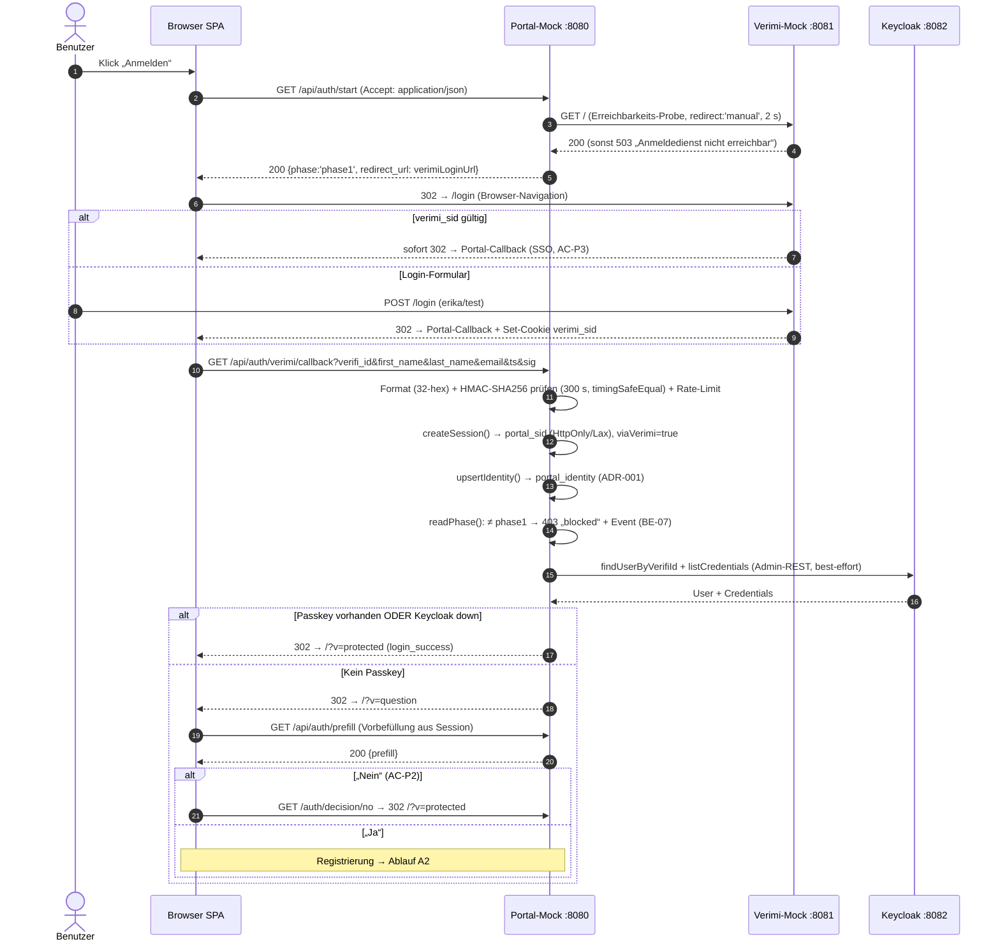
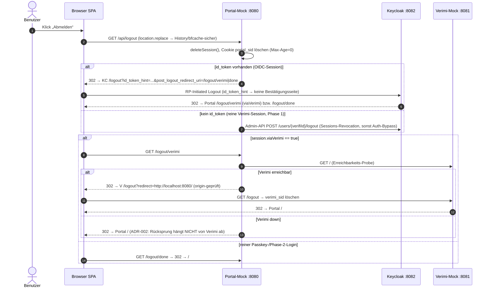

# Authentifizierungs-Sequenzdiagramme (Ist-Stand aus dem Code)

Stand: 2026-10-13 — abgeleitet **direkt aus dem Prototyp-Code**, keine Soll-Architektur.

Quellen: `prototype/portal-mock/src/routes/public.js`, `prototype/portal-mock/src/keycloak.js`,
`prototype/verimi-mock/src/server.js`, `prototype/portal-mock/public/app.js`,
`prototype/keycloak/setup-realm.mjs`.

---

## Überblick: Was der Code wirklich tut

Der Authentifizierungsprozess besteht aus **vier getrennten Abläufen**, nicht aus einem einzelnen Flow.

| Weg | Auslöser | Kern-Endpunkte | Quelle |
|---|---|---|---|
| **A. Verimi-Login (Phase 1)** | Button „Anmelden“ | `GET /api/auth/start` → `GET /api/auth/verimi/callback` | `public.js:97–275` |
| **A2. Passkey-Registrierung** | „Ja“ + Formular | `POST /api/registration` → `kc/start(context=register)` → `kc/callback` | `public.js:303–500` |
| **B. Passkey-Login / Phase 2** | Button „Passkey Login“ bzw. „Anmelden“ in Phase 2 | `kc/start(context=login)` → `kc/callback` (browser-passkey-Flow) | `public.js:388–500`, `setup-realm.mjs` |
| **C. Logout (alle 3 Sessions)** | „Abmelden“ | `GET/POST /api/logout` → KC-Logout + optional Verimi | `public.js:572–620` |

Wichtige Code-Tatsachen, die die Abläufe prägen:

- **Verimi-Rückleitung ist HMAC-signiert**: `HMAC-SHA256(ts.verifi_id.first_name.last_name.email)`, 300-s-Fenster, `timingSafeEqual` (`public.js:147–156`).
- **Keycloak ist „best-effort“ beim Verimi-Login**: Die Passkey-Prüfung darf den Login nicht brechen (try/catch, `public.js:241–250`).
- **Registrierung nutzt Impersonation + SSO-Cookie-Relay** (Variante A, KC 26.7), Client `portal-bootstrap`, Standard-browser-Flow (`keycloak.js:133–149`, `setup-realm.mjs:8–13`).
- **Login nutzt Flow `browser-passkey`** (username-los, Cookie-Execution OFF), Client `portal-mock` (`setup-realm.mjs:47–48`).
- **PKCE S256 + serverseitige Token-Prüfung** (Issuer/JWKS/`azp`/`aud`-Toleranz) (`keycloak.js:177–250`).

---

## Ablauf A — Verimi-Login („Anmelden“, Phase 1)

```asciidoc
Browser/SPA                Portal-Mock :8080             Verimi-Mock :8081             Keycloak :8082
     │                          │                             │                            │
     │── 1 · GET /api/auth/start (Accept: application/json) ──▶
     │                          │── 2 · GET /  (Erreichbarkeits-Probe, redirect:'manual', 2 s) ──▶
     │                          │◀── 200 ──────────────────────│
     │◀─ 3 · 200 {phase:'phase1', redirect_url: verimiLoginUrl}│
     │ 4 · 302 → http://localhost:8081/login (Browser-Navigation)
     │───────────────────────────────────────────────────────▶ │
     │ 5a · verimi_sid-Cookie gültig → sofortige Rückleitung (SSO-Effekt, AC-P3)
     │◀────────────────────────────────────────────────────────│
     │   … oder: 5b · POST /login (erika/test)                 │
     │───────────────────────────────────────────────────────▶ │ 6 · user/password prüfen,
     │                                                         │   Set-Cookie verimi_sid
     │ 7 · 302 → /api/auth/verimi/callback?verifi_id&first_name&last_name&email&ts&sig
     │───────────────────────────────────────────────────────▶ │
     │                          │  8 · Format (32-hex) + HMAC-SHA256 prüfen (300 s, timingSafeEqual)
     │                          │  9 · Rate-Limit (429) · createSession() → portal_sid (HttpOnly/Lax)
     │                          │ 10 · session.viaVerimi = true
     │                          │ 11 · upsertIdentity() → portal_identity (Portal-DB, ADR-001)
     │                          │ 12 · readPhase(): ≠ phase1 → 403 „blocked“ + Event (BE-07)
     │                          │ 13 · Passkey-Prüfung (BEST-EFFORT, try/catch):
     │                          │── findUserByVerifiId + listCredentials (Admin-REST) ──▶
     │                          │◀── User + Credentials ───────│
     │                          │ 14a · Passkey vorhanden ODER KC down: 302 → /?v=protected + login_success
     │◀────────────────────────│
     │                          │ 14b · kein Passkey: 302 → /?v=question
     │◀────────────────────────│
     │── 15 · GET /api/auth/prefill ──▶
     │◀─ 16 · 200 {prefill} ────────│
     │ 17 · „Nein“ → GET /auth/decision/no → session.decision='no' → 302 /?v=protected (AC-P2)
     │ 17 · „Ja“   → Registrierungsformular → siehe Ablauf A2
```

**Mermaid (renderbar):**



---

## Ablauf A2 — Passkey-Registrierung („Ja“, Impersonation + Required Action)

```asciidoc
Browser/SPA                Portal-Mock :8080                     Keycloak :8082
     │                          │                                    │
     │── 1 · POST /api/registration {first_name,last_name,email} ──▶
     │                          │ 2 · Form/Inhalt prüfen (100/254, E-Mail-Regex)
     │                          │    + zwingend Übereinstimmung mit Session-Prefill (FR-15/BE-03)
     │                          │ 3 · KC-User fehlt? → createUser (username=verifi_id)
     │                          │── POST /admin/.../users ──────────▶
     │                          │ 4 · setRequiredAction('webauthn-register-passwordless')
     │                          │── PUT /users/{id} ────────────────▶
     │                          │ 5 · POST /users/{id}/impersonation (Variante A, KC 26.7)
     │                          │◀── 201 + Set-Cookie KEYCLOAK_IDENTITY (SSO-Cookie-Relay)
     │◀─ 6 · 201 {registration_id, ceremony:{mode:'keycloak-required-action',
     │        redirect_to:'/api/auth/kc/start?context=register'}} + Set-Cookie (Relay)
     │                          │
     │ 7 · w.close() (Same-Origin) → location.assign('/api/auth/kc/start?context=register')
     │── 8 · GET /api/auth/kc/start?context=register ──▶
     │                          │ 9 · kcAuth.context='register' nötig (sonst /?v=error&m=registration)
     │                          │ 10 · verifier = randomBytes(48); Client = portal-bootstrap
     │                          │ 11 · buildAuthUrl (PKCE S256, state=portal_sid)
     │◀─ 12 · 302 → KC /auth (Standard-browser-Flow) ──│
     │────────────────────────────────────────────────▶ 13 · SSO-Cookie gilt (Impersonation) →
     │                                                  │   eingeloggt → Required Action
     │◀── 14 · WebAuthn create() (resident/discoverable) ──│
     │ 15 · Benutzer bestätigt (PIN/Biometrie)
     │────────────────────────────────────────────────▶ 16 · Credential gespeichert
     │◀── 17 · 302 → /api/auth/kc/callback?code&state ──│
     │── 18 · GET /api/auth/kc/callback?code&state ──▶
     │                          │ 19 · exchangeCodeAndVerify (PKCE, Client portal-bootstrap)
     │                          │── POST /token ─────────────────▶
     │                          │◀── access_token + id_token ─────│
     │                          │ 20 · Token prüfen (Issuer/JWKS/azp/aud); payload.sub == kcAuth.kcUserId
     │                          │ 21 · setAttribute('passkey_registered','true')
     │                          │ 22 · Event 'registration' → event_log
     │◀─ 23 · 302 → /?v=protected ────│ (session.passkeyAuth = true)
```

---

## Ablauf B — Passkey-Login („Passkey Login“ / Phase-2 „Anmelden“)

```asciidoc
Browser/SPA                Portal-Mock :8080                     Keycloak :8082
     │                          │                                    │
     │ 1 · Einstieg:                                            │
     │   a) Klick „Passkey Login“ → location.assign('/api/auth/kc/start?context=login')
     │   b) Phase 2 „Anmelden“ → GET /api/auth/start → 200 {phase:'phase2',
     │      redirect_url:'/api/auth/kc/start?context=login'} (KC-Probe vorab)
     │── 2 · GET /api/auth/kc/start?context=login ──▶
     │                          │ 3 · KC-Probe (.well-known/openid-configuration)
     │                          │ 4 · Session fehlt → anonyme Session (verifiId=null)
     │                          │ 5 · verifier; Client = portal-mock; buildAuthUrl
     │◀─ 6 · 302 → KC /auth (Flow browser-passkey, PKCE S256, state=portal_sid) ──│
     │────────────────────────────────────────────────▶ 7 · browser-passkey-Flow:
     │                                                  │   username-los, Cookie-Execution OFF
     │◀── 8 · WebAuthn get() (discoverable Credential) ──│
     │ 9 · Benutzer wählt/bestätigt Passkey
     │────────────────────────────────────────────────▶ 10 · Assertion prüfen
     │◀── 11 · 302 → /api/auth/kc/callback?code&state ──│
     │── 12 · GET /api/auth/kc/callback?code&state ──▶
     │                          │ 13 · exchangeCodeAndVerify (PKCE, Client portal-mock)
     │                          │── POST /token ─────────────────▶
     │                          │◀── access_token + id_token ─────│
     │                          │ 14 · Token prüfen; verifiId = payload.preferred_username
     │                          │     user.id == payload.sub (sonst /?v=error&m=foreign)
     │                          │ 15 · portal_identity fehlt? → aus KC-Profil upsertIdentity()
     │                          │ 16 · Event 'login_success' → event_log; passkeyAuth=true
     │◀─ 17 · 302 → /?v=protected ──│
     │── 18 · GET /api/session ──▶ │
     │◀─ 19 · 200 {display_name, phase, passkey:true} ──│ (Name aus portal_identity, ADR-001)
```

---

## Ablauf C — Logout (Portal + Keycloak-SSO + Verimi-SSO)



---

## Code-Stellen (Traceability)

| Diagramm-Schritt | Datei:Zeile |
|---|---|
| A1 `/api/auth/start` + Phasenschalter | `public.js:97–140` |
| A1 Erreichbarkeits-Probe (Verimi/KC) | `public.js:74–86` |
| A1 Verimi-Callback, HMAC, blocked, Passkey-Check | `public.js:158–275` (Sig: 147–156) |
| A1 JSON-Sonderfall ohne Params (SPA-Zustandsabfrage `passkey_exists`/`prefill`) | `public.js:167–175` |
| A1 Prefill | `public.js:280–284` |
| A1 „Nein“ | `public.js:289–294` |
| A2 `POST /api/registration` (Prefill-Zwang FR-15/BE-03) | `public.js:303–383` |
| A2 Impersonation + SSO-Cookie-Relay | `keycloak.js:133–149` |
| A2 `setRequiredAction` / `setAttribute` / `logoutUser` | `keycloak.js:101–122` |
| A2+B `kc/start` (Verifier, Client-Wahl bootstrap vs. portal-mock) | `public.js:388–421` |
| A2+B `kc/callback` (Code-Tausch, Token-Prüfung, sub-Check) | `public.js:426–500`, `keycloak.js:177–234` |
| B Login-Flow `browser-passkey`, WebAuthn-Policies | `setup-realm.mjs:102–126, 190` |
| C `/api/logout` + `/logout/verimi` + `/logout/done` | `public.js:572–620` |
| C Verimi-Mock `/login` + `/logout` (Origin-Lock) | `verimi-mock/src/server.js:141–178` |
| C OIDC-Logout-URL mit `id_token_hint` | `keycloak.js:264–272` |
| Frontend-Aktionen (Buttons, Ceremony, bfcache) | `public/app.js:54–84, 121–181, 197–233` |

---

## Anmerkungen (Architektur-Sicht)

- **Vier eigenständige Wege, ein Session-Modell**: `portal_sid` (Portal) + KC-SSO-Cookie + `verimi_sid` laufen parallel — der Logout muss alle drei treffen, sonst SSO-Auth-Bypass (Issue 2). Genau das macht Ablauf C.
- **Trennung „Registrieren“ vs. „Login“-Flow** ist eine bewusste KC-26.7-Notwendigkeit (bootstrap-Client mit Standard-browser-Flow, weil die Required Action sonst nie gerendert wird) — siehe `setup-realm.mjs:8–13`. Klarer Fall von „Impl-Detail, das man nicht versehentlich vereinfachen sollte“.
- **Undokumentierte Endpunkte (Gap M1)**: Die Diagramme zeigen, warum M1 relevant ist — `/api/auth/prefill`, `/auth/decision/no`, `/api/auth/kc/start`, `/api/auth/kc/callback`, `/api/logout`, `/logout/verimi`, `/logout/done` sind die **tragenden Ablaufwehre** des Prototyps, fehlen aber in `technical-spec.md`. Ein späterer Produktiv-Aufbau (OIDC-Server-basiert) würde sie ersetzen — bis dahin gehören sie dokumentiert.
- **Kleiner code-seitiger Restschmutz**: In Ablauf A fehlt in `app.js` der Aufruf des JSON-Pfads von API-02 (`public.js:167–175`) — wird laut Kommentar „vom SPA genutzt“, ist aber nirgends verdrahtet. Harmlos, aber toter Code-Comment.
